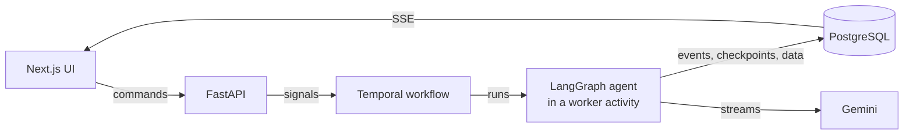

# Live Company Check

An AI assistant that runs a company due-diligence check together with a human reviewer:
live streaming, interactive questions, pause/resume, feedback rounds and inline charts.

**Stack:** Python 3.12 + FastAPI, LangGraph, Temporal, PostgreSQL, Next.js, Gemini

- [docs/ARCHITECTURE.md](docs/ARCHITECTURE.md): components, agent graph, workflow states, failures
- [docs/DECISIONS.md](docs/DECISIONS.md): decisions and trade-offs
- [docs/PROGRESS.md](docs/PROGRESS.md): status, bugs found, verified scenarios
- [docs/PLAN.md](docs/PLAN.md): the original plan and build order

## What it does

| Requirement | How |
|---|---|
| Live streaming | Every step is an event in Postgres, streamed over SSE; refresh or reconnect replays the same view |
| Questions | Single choice (ambiguous name), multiple choice and free text; answered once even on double click |
| Pause / resume | Pause stops the agent within about a second, mid-sentence if need be; resume continues the text. Survives restarts of the API, worker and Temporal, and pauses of hours |
| Feedback rounds | Send feedback any time (queued while busy); only work it affects is redone; repeats are no-ops; long sessions continue as new |
| Visualization | Rating trend, news timeline, ratings by period, company comparison; computed from data, updated in place by feedback ("last 12 months", "mark the sale date") |
| Failures | Retries with backoff, model fallback, plain error messages with Retry, graceful worker shutdown |



## Quick start (everything in Docker)

Prerequisites: Docker and a Google AI Studio API key.

```bash
cp .env.example .env                 # set GOOGLE_API_KEY
docker compose --profile app up -d --build
```

Open http://localhost:3000. The API is on 8000 and the Temporal UI on 8233. The `migrate`
service creates the tables and loads the companies from `data/dummy_data.json` (the
`sample_checks` section is never loaded).

## Development setup

Prerequisites: Docker, [uv](https://docs.astral.sh/uv/), Node 20+.

```bash
cp .env.example .env            # add your GOOGLE_API_KEY
docker compose up -d            # Postgres (5433) + Temporal (7233, UI on 8233) only

cd backend
uv sync
uv run alembic upgrade head     # create tables
uv run python -m company_check.seed   # load companies

uv run uvicorn company_check.api.app:app --reload --port 8000   # API
uv run python -m company_check.worker.main                      # worker (2nd terminal)

cd ../frontend
npm install
npm run dev                     # http://localhost:3000
```

Health check: `curl localhost:8000/health` returns `{"database":"ok","temporal":"ok"}`.

## Tests

```bash
cd backend && uv run pytest     # needs Postgres running and seeded; never calls the LLM
cd frontend && npx tsc --noEmit && npm run lint
```

Workflow tests run on Temporal's time-skipping test server with fake activities (questions,
double clicks, pause and resume, answers while paused, an 8-hour pause, retry after failure,
queued feedback, continue-as-new). Agent pieces are tested without the LLM; the agent itself
is exercised live with the scripts below.

## Scenario scripts

With the API and worker running:

```bash
cd backend
uv run python scripts/pause_mid_report.py "Copperleaf Software"   # pause mid-report, resume, check the seam
uv run python scripts/verify_stream.py <check_id>                 # visible text == final report?
uv run python scripts/feedback.py <check_id> "Only show the last 12 months" --target chart:chart-1
uv run python scripts/feedback.py <check_id> "<same text>" --times 2     # repeat → no-op
uv run python -m company_check.cli "Brightline Logistics"         # run the agent in the terminal
```

## Repository layout

```
backend/    FastAPI API, Temporal worker (workflows + activities), LangGraph agent, Alembic
frontend/   Next.js reviewer UI
data/       dummy_data.json (seed data)
docs/       architecture, decisions, progress, plan
```
