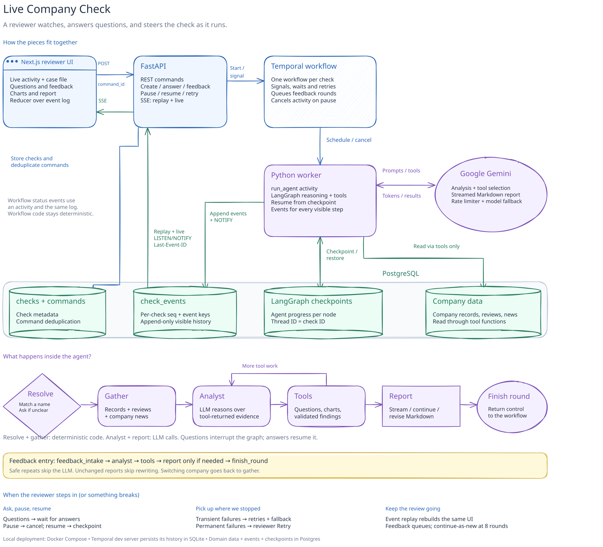
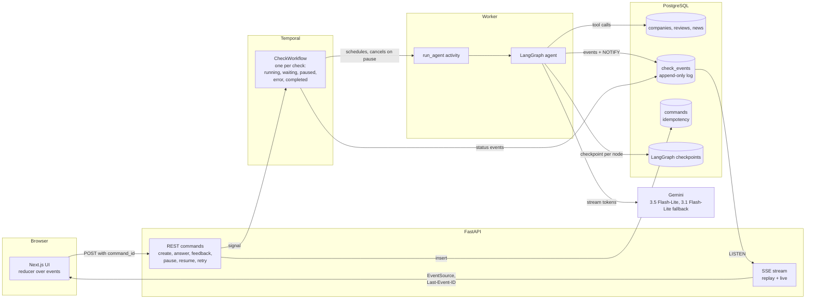
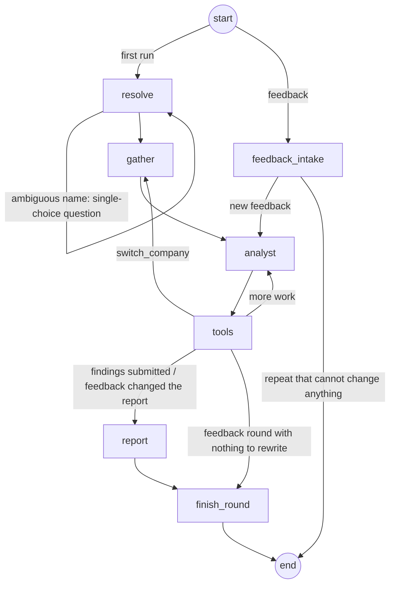
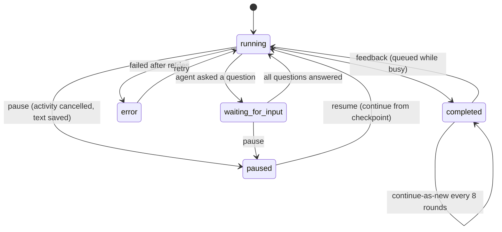
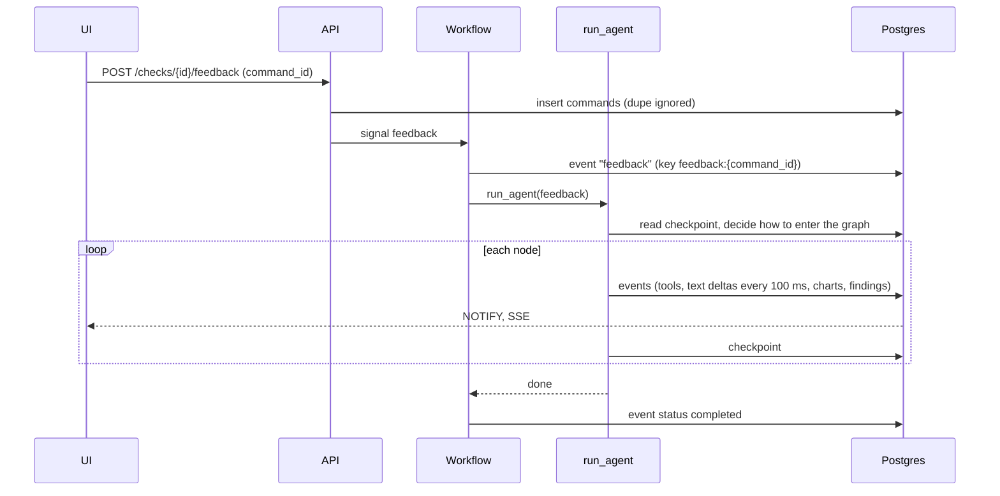

# Architecture

Each concern has one owner. Temporal decides **when** the agent runs, LangGraph decides
**what** it does, Postgres stores **what the reviewer sees**, and the browser folds that
log into the UI.

The diagram covers the system, agent flow and recovery guarantees.

## Components

| Concern | Owner | Why |
|---|---|---|
| Control flow: running, waiting for an answer, paused, error, waiting for feedback | Temporal workflow | Survives restarts; waits for hours at no cost; signals for commands |
| Agent reasoning | LangGraph, run inside a Temporal activity | Workflow code must be deterministic; LLM and DB calls are not |
| Agent progress | LangGraph Postgres checkpointer (thread = check id) | Resume or retry continues from the last finished node |
| What the reviewer sees | `check_events` (per-check `seq`, idempotency keys) | Refresh or reconnect replays exactly what was shown |
| Domain data | Postgres tables, read only through tool functions | The LLM never sees the raw data file |

## Agent graph

- **resolve** and **gather** are plain code: trigram name search, then company, reviews and
  news. An ambiguous name pauses the graph with a single-choice question (`interrupt`).
- **analyst** is one LLM call; **tools** runs the calls it asked for in a separate node, so
  a question (`interrupt`) never repeats the LLM call when the graph resumes.
- First run tools: `ask_reviewer`, `search_news`, four chart and table tools,
  `submit_findings`. Feedback-round tools: `exclude_evidence`, `update_findings`,
  `revise_report`, `switch_company`, plus the chart tools and `search_news`.
- **report** streams Markdown. After a pause or crash it continues the text the reviewer
  already saw; in a feedback round it revises the previous version.

## Workflow

## A reviewer command, end to end

Pause cancels the activity through its heartbeat; it saves streamed text and stops.
Resume runs it again and it continues from the last checkpoint. Every command carries a
client-generated `command_id`, deduplicated by the API and again in the workflow.

## Failures

| Failure | What happens |
|---|---|
| LLM overload (503), rate limit (429), timeout | Model fallback, then Temporal retries with backoff; the UI shows "Recovering from a temporary problem" |
| Bad API key or billing (401/402/403) | Fails fast (not retried); the check shows a plain message and a Retry button |
| Agent doesn't finish within 8 turns | It is told to finish now; only if that fails does the check go to error |
| Malformed tool call | The validation error goes back to the model to fix |
| Worker killed mid-stream | Heartbeat timeout, then a retry continues from the checkpoint; a half-written report is continued, not repeated |
| Worker stopped (`docker stop`) | Graceful shutdown: running agents get 5 s to finish or save progress |
| API restarted | Stateless; browsers reconnect with `Last-Event-ID` |
| Temporal restarted | Workflow state is in its SQLite file; paused and waiting checks survive |
